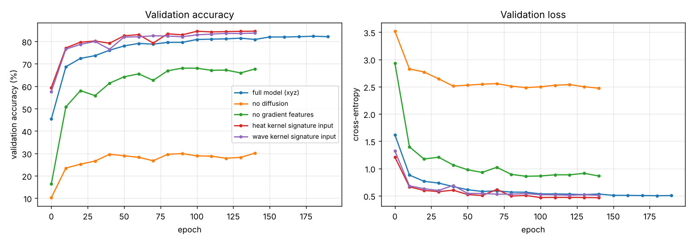

# DiffusionNet for RNA surface segmentation

A PyTorch implementation of DiffusionNet ([Sharp, Attaiki, Crane and Ovsjanikov, 2022](https://arxiv.org/abs/2012.00888)), trained to label every vertex of an RNA molecule's surface mesh with one of 160 classes. It was written for the practical session of the MVA course *Geometry Processing and Geometric Deep Learning* at ENS Paris-Saclay, starting from the course's notebook skeleton.

| Input features | Validation accuracy | Weights |
| --- | --- | --- |
| Heat kernel signature | **84.59%** | [`weights/hks.pth`](weights/hks.pth) |
| Wave kernel signature | 83.73% | [`weights/wks.pth`](weights/wks.pth) |
| Raw coordinates $xyz$ | 82.15% | [`weights/xyz.pth`](weights/xyz.pth) |
| $xyz$, no learned diffusion | 30.13% | [`weights/xyz_no_diffusion.pth`](weights/xyz_no_diffusion.pth) |
| $xyz$, no gradient features | 67.72% | [`weights/xyz_no_gradient.pth`](weights/xyz_no_gradient.pth) |



## The task

Each sample is a triangle mesh $(V, F)$ of the molecular surface of an RNA strand, with $V \subset \mathbb{R}^3$ the vertices and $F$ the triangles, and one label per vertex saying which part of the molecule it lies on. The training set has 547 meshes. The meshes come in no canonical orientation and their vertex counts vary, so the model has to work on any discretisation of the surface and should not depend on how the molecule is rotated.

## How the network works

Everything below lives on the surface $S$ approximated by the mesh. A feature is a function $u : V \to \mathbb{R}^C$, one vector of $C$ channels per vertex.

**Precomputed operators.** For each mesh, before training:

- $L \in \mathbb{R}^{|V| \times |V|}$ is the cotangent Laplacian, the standard discretisation of the Laplace–Beltrami operator of $S$.
- $M$ is the diagonal mass matrix, whose entry $M_{ii}$ is the area attached to vertex $i$ (one third of the area of its incident triangles).
- $(\lambda_k, \phi_k)_{k=1}^{K}$ are the first $K = 128$ solutions of the generalised eigenproblem $L \phi = \lambda M \phi$, with $0 = \lambda_1 \le \lambda_2 \le \dots$. They are the low frequencies of the surface, and $\Phi = [\phi_1, \dots, \phi_K]$ stacks them as columns.
- For each vertex a tangent frame, and two sparse matrices $G_X, G_Y$ that send a scalar function to the two components of its gradient in that frame.

**Learned diffusion.** The heat equation $\partial_t h = -\Delta h$ with $h(0) = u$ spreads $u$ over the surface, and its solution at time $t$ is approximated in the spectral basis by

$$h_t = \Phi \mathrm{diag}\big(e^{-\lambda_1 t}, \dots, e^{-\lambda_K t}\big) \Phi^{\top} M u .$$

Each channel has its own time $t_c \ge 0$, and these times are parameters learned by gradient descent. A small $t_c$ keeps the channel local, a large one averages it over most of the molecule, so the network chooses its own receptive field per channel. Because $L$, $M$ and $\Phi$ only depend on the intrinsic geometry, this step gives the same result whatever the mesh's resolution or orientation.

**Gradient features.** Diffusion alone is isotropic. To see directions, each diffused channel $h_c$ gets a gradient $w_c = (G_X h_c) + i(G_Y h_c) \in \mathbb{C}$ at each vertex, written as a complex number in the local frame. A learned complex matrix $B$ mixes the channels, and the network keeps

$$g_c = \tanh\big(\mathrm{Re}(\overline{w_c} (B w)_c)\big).$$

Changing the tangent frame at a vertex multiplies every $w_c$ there by the same unit complex number, which cancels in $\overline{w_c}(Bw)_c$, so $g$ does not depend on the arbitrary choice of frames.

**Blocks.** A block takes $u$, computes $h_t$ and $g$, feeds the concatenation $[u, h_t, g]$ to a pointwise MLP (the same MLP at every vertex, with dropout), and adds the result back to $u$. The full network is a linear layer from the input features to 128 channels, four blocks, and a linear layer to the 160 class scores.

**Input features.** Besides raw coordinates, two intrinsic descriptors built from the same eigenpairs were tried, each sampled at 32 scales. The heat kernel signature of vertex $x$ at time $s$ is $\sum_k e^{-\lambda_k s} \phi_k(x)^2$, how much heat started at $x$ is still there after time $s$; the wave kernel signature replaces the heat filter with band-pass filters in $\log \lambda$. Both are invariant to rotations by construction.

## Reading the results

- **Learned diffusion carries the model.** Without it, a vertex only sees its own features and the gradients around it, and accuracy falls from 82.2% to 30.1%.
- **Gradient features add 14.4 points** (67.7% without them). Diffusion tells a vertex what surrounds it; gradients tell it in which direction things change.
- **Intrinsic inputs beat coordinates.** The heat kernel signature reaches 84.6% and the wave kernel signature 83.7%, against 82.2% for $xyz$. The meshes are not aligned, so with $xyz$ the network has to learn the same labels for every orientation, while the signatures are already rotation invariant.

## Training setup

- Loss: cross-entropy over the 160 classes, one label per vertex.
- Optimizer: Adam, learning rate $10^{-3}$ halved every 50 epochs, weight decay $10^{-4}$.
- Epochs: 200 for the full $xyz$ model, 150 for the ablations and the signature inputs.
- Hardware: Google Colab, one L4 GPU.

## Running it

[`diffusionnet_rna.ipynb`](diffusionnet_rna.ipynb) is meant for Google Colab. Its first cells download the course's utility code and the [RNA surface segmentation dataset](https://github.com/nmwsharp/RNA-Surface-Segmentation-Dataset); the operators are then precomputed for every mesh (this takes a while, so the notebook caches them on Google Drive). The model classes are defined in the notebook: `xyz.pth` was trained with `DiffusionNet`, the other four with `DiffusionNetExtra`, which adds switches to turn diffusion or gradient features off.

```python
model = DiffusionNetExtra(p_in=32, p_out=160, n_channels=128, N_block=4)  # p_in=3 for xyz
model.load_state_dict(torch.load("weights/hks.pth", map_location="cpu"))
model.eval()
```

## References

- N. Sharp, S. Attaiki, K. Crane, M. Ovsjanikov. *DiffusionNet: Discretization Agnostic Learning on Surfaces.* ACM Transactions on Graphics, 2022. [arXiv:2012.00888](https://arxiv.org/abs/2012.00888)
- The RNA segmentation dataset was introduced by A. Poulenard, M.-J. Rakotosaona, Y. Ponty, M. Ovsjanikov. *Effective Rotation-invariant Point CNN with Spherical Harmonics Kernels.* 3DV, 2019.
